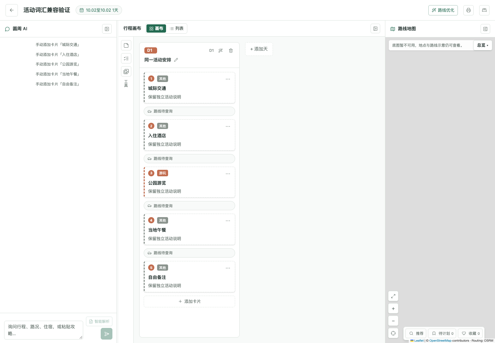
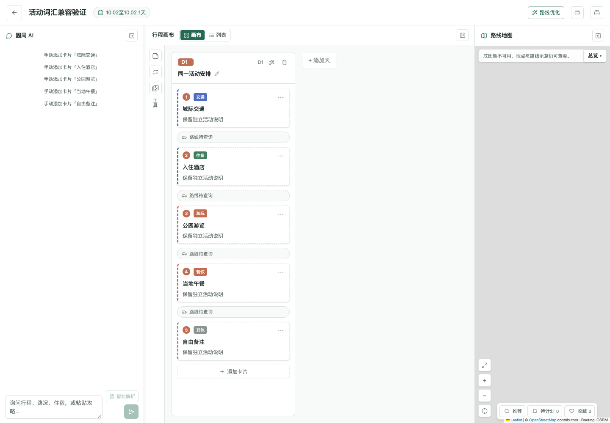

# 活动类型通过边界适配兼容目标词汇

现有 SQLite、公开响应和工作台消费者使用 `traffic|stay|attraction|food|other`，Issue #4 使用 `transit|accommodation|attraction|dining|note`。沿用已确认的兼容增量决定：输入边界接受两套词汇，将目标词汇适配为现有类型再进入保存、住宿约束和界面消费者；保留现有公开 `type`，避免让规格对齐变成历史数据与调用者的破坏性迁移。

| 输入词汇 | 保存与响应的 `type` |
| --- | --- |
| `transit` / `traffic` | `traffic` |
| `accommodation` / `stay` | `stay` |
| `attraction` | `attraction` |
| `dining` / `food` | `food` |
| `note` / `other` | `other` |

共享 Zod 定义两套枚举及联合输入；同一适配器用于实际 SQL/内存 writer、旧行读取投影、item 创建、TripPatch、proposal 和浏览器 decoder。AI 工具输入 Schema 保持可导出 JSON Schema，在解析边界适配；结构化 GuideDraft 在 Schema 内适配，导入 fingerprint 因而沿用旧词汇。旧草稿的字段顺序和 hash 不变，同一 importId 的语义等价别名可重放，改变作者说明仍冲突。外部攻略 extraction 的词汇、prompt 和 POI 检索行为保持原样。

`ActivityItemSchema` 与工作台的既有乐观创建类型继续只描述现有词汇，扩展的 API 请求类型单独接受别名；不让新词汇直接进入原有 renderer。item PATCH 保持已有字段范围，类型修改仍通过既有 content PUT / `update_item` 完成。只识别精确字符串，缺失/无效输入沿用各入口原有处理；content 的旧 trim/任意类型字符串协议保留，未知字符串在 content 读取中仍原样返回、在画布仍按 `other` 容错。读取识别已保存别名时只投影，不回写或迁移历史行。

`timeRange` / `cost` 延续 PR #21：独立可选作者原文 string，省略更新保留，空串清空，`null` / 非字符串写入拒绝，读取坏可选字段独立省略；`"0"` 是合法文本，数字 `0` 不合法。无币种、金额或时间区间计算，不从散文或 POI 推断。活动所属 Day/Trip 的现有检查保留，content 及直接 item upsert 额外拒绝复用其他 Trip 的 item id。

## 实际界面对照

真实 Chromium、Vite、生产 Hono、隔离 SQLite；同一 1440×1000 视口、浅色主题、固定 2026-10-02 行程、一个 Day、相同五项标题/备注，通过生产 client 依次提交 `transit`、`accommodation`、`attraction`、`dining`、`note`。无外部 AI/地图调用，无 UI 响应或 fetch/EventSource 替换。Before 为基线 `6ca5f457bc7fea33900633dd4b712deb119e5bcb`，After 的具体提交在 PR 描述中标注；两图均为实际应用截图。

Before：旧创建入口将四个未识别别名归为“其他”。

After：对应显示既有“交通”“住宿”“游玩”“餐饮”“其他”分类与样式，没有新增布局或样式。

这只完成 Activity 契约兼容增量。Stash 独立 note 与 `add_stash` / `move_stash_to_day`、完整原子补丁及通用操作排序问题、`geographicFactCheck`、Leg.status 的来源信任语义、其余 Issue #4/#9 验收仍待后续工作包处理。
