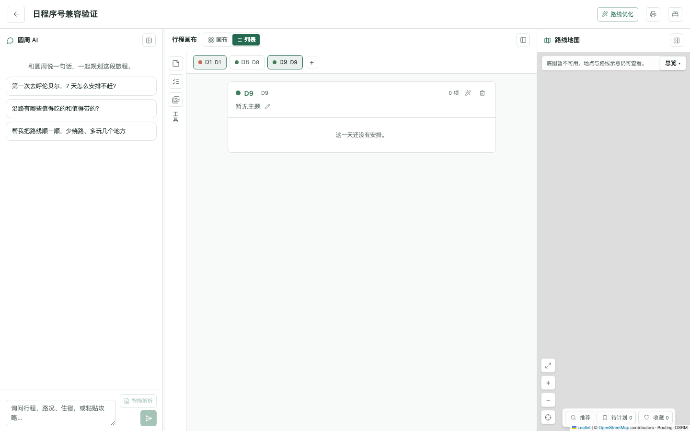
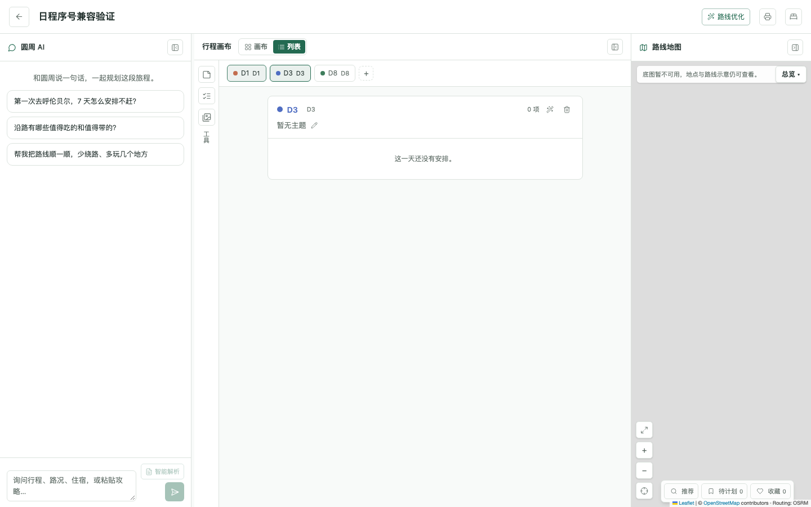

# Day identity: actual Before / After evidence

The same real add-day action renders **D9 on the baseline** and **D3 on the implementation**. Both images show the state after clicking the app's real `+` button, whose accessible name is `添加一天`, then selecting the newly created day's tab. The comparison is between code revisions, not between pre-click and post-click states.

| Baseline | Implementation |
| --- | --- |
|  |  |

| Binding / observation | Before | After |
| --- | --- | --- |
| Exact commit | `954ad6d05088dbed348dcfa650b00b53c37dc407` | `d0ca5854065f4163a0cb93b90e491a4e0b608e7d` |
| Git tree | `799e743ed5e9e3fa61276e636ef4664120666938` | `08e1852a631ff211da6be43841d66c9fd7ec8224` |
| Capture time (UTC) | `2026-11-13T04:21:49.167Z` | `2026-11-13T04:22:54.730Z` |
| Hono / Vite ports | `62813` / `62814` | `64031` / `64032` |
| Real POST status | `201` | `201` |
| POST `day.index` | `8` (stale, before compaction) | `2` (authoritative, after compaction) |
| POST `day.dayNumber` | absent | `3` |
| POST `day.tripId` | absent | `evidence-day-identity` |
| Selected rendered day | `D9` | `D3` |
| Server canvas index for created day, read after screenshot | `2` | `2` |
| Canvas requests before click / at screenshot | `5` / `5` | `5` / `5` |
| Actually aborted SSE requests | `3` | `3` |
| Unhandled browser errors | none | none |

The baseline and implementation were each extracted with `git archive` into a separate new temporary directory and installed separately with `pnpm install --frozen-lockfile`. They do not share a mutable workspace `node_modules` or domain build. A final Git blob comparison verified every archived tracked file against its declared commit: 312 files before, 316 files after.

The image SHA-256 values were checked against the recorded manifests:

- [before.png](./before.png): `5640653fe6369fa3197d2a1e451e0356e5d0c3ec3ae228f3d26c8aacbc46d949`
- [after.png](./after.png): `656623b79ee911d9dfc7301a12b2ae63a442061d492716cb2953d211aa0dbf27`

## Controlled scenario

Both runs use the actual Hono server entry, local SQLite via the application's normal repository code, and the actual Vite/React frontend. Each run owns a fresh database, spare ports, browser context, and Vite cache. No API response, day record returned to the client, component, or rendered text was mocked.

After the application creates its real schema, the capture script inserts identical persisted fixture rows into SQLite: trip `evidence-day-identity`, title `日程序号兼容验证`, empty start/end dates, and two empty days with sparse indices `0` and `7`. The day themes are `已有日程一` and `已有日程二`; their colors are `#c26d4f` and `#3f7d5c`. There are no items or legs. Fixed fixture timestamps have no effect on the undated display. The complete initial database rows are included in both manifests and were compared for exact equality.

The browser enters `/?view=workbench&trip=evidence-day-identity`, switches to list view, clicks the real `添加一天` control, and selects the returned day's real tab. All three columns remain open. The screenshot is the app's normal rendering, with no injected overlays, CSS, or label changes.

Both captures use a 1440 × 900 viewport, device scale factor 1, light color preference, the default application theme (empty root/body class lists), locale `zh-CN`, and timezone `Asia/Shanghai`. Both used Node `v24.22.1`, pnpm `11.17.0`, repository Playwright `1.62.1`, and the same installed Chromium `156.0.8078.4` executable.

## Assertions and scope

SSE is deliberately held offline on both runs using Playwright `page.route('**/events*', route => route.abort('blockedbyclient'))`. All non-local browser requests are also aborted, including the external map tiles. All other app/API traffic goes to the actual local servers unchanged. The request counters prove that no canvas refetch occurred between the add-day click and screenshot, so the displayed new day comes from the POST response.

The existing second day still shows `D8` in the after image. The server has compacted it to index `1`, but the current UI patches only the returned new day while SSE is interrupted. The new day therefore sorts before that existing tab in the after image. This evidence specifically demonstrates the corrected mutation response under offline realtime; it does not claim full-list reconciliation while realtime remains unavailable. A separate authoritative canvas read is made only after each screenshot and confirms final indices `0, 1, 2`.

The script also imports the real `/src/domain/workbench.ts` module in the browser runtime and calls its exported `fetchTripCanvas` and `createWorkbenchDay` functions. It uses a second identical persisted trip, `evidence-day-identity-client`, so this extra real mutation cannot alter the screenshot scenario. The changed client preserves the initial day projections `(index: 0, dayNumber: 1)` and `(index: 7, dayNumber: 8)` plus the correct `tripId`, and preserves the created day's `index: 2`, `dayNumber: 3`, and correct `tripId`. The baseline client's real create result has index `8` with no identity projections. Subsequent real canvas reads confirm compacted indices.

Full factual results, runtime command arguments, network requests, and cleanup records are in [before.json](./before.json) and [after.json](./after.json). Accessibility snapshots in [before-aria.txt](./before-aria.txt) and [after-aria.txt](./after-aria.txt) independently confirm the selected `D9` / `D3` tab and matching visible day labels.

Map tiles are unavailable by design, and the app shows its normal map-unavailable message. No model or map network credentials were provided or needed; chat/model generation and provider-backed maps were not exercised. Each browser was closed and each server/Vite child was terminated and collected. A final check confirmed that the four successful capture server PIDs were absent and all capture ports were closed, including ports from the initial failed browser-launch attempt.

## Commands used and reproduction

Run from the repository root. These were the actual archive/install commands; the temporary directory suffixes below are the paths produced during this run.

```bash
BASELINE_DIR=$(mktemp -d /tmp/travles-day-identity-baseline-XXXXXX)
git archive 954ad6d05088dbed348dcfa650b00b53c37dc407 | tar -x -C "${BASELINE_DIR:?}"
pnpm --dir "${BASELINE_DIR:?}" install --frozen-lockfile

AFTER_DIR=$(mktemp -d /tmp/travles-day-identity-after-XXXXXX)
git archive d0ca5854065f4163a0cb93b90e491a4e0b608e7d | tar -x -C "${AFTER_DIR:?}"
pnpm --dir "${AFTER_DIR:?}" install --frozen-lockfile
```

Actual successful capture commands:

```bash
PLAYWRIGHT_CHROMIUM_EXECUTABLE=/Users/eamon.j.he/Library/Caches/ms-playwright/chromium_headless_shell-1248/chrome-headless-shell-mac-arm64/chrome-headless-shell node docs/evidence/day-identity/capture.mjs --root /tmp/travles-day-identity-baseline-ecZVTQ --label before --revision 954ad6d05088dbed348dcfa650b00b53c37dc407

PLAYWRIGHT_CHROMIUM_EXECUTABLE=/Users/eamon.j.he/Library/Caches/ms-playwright/chromium_headless_shell-1248/chrome-headless-shell-mac-arm64/chrome-headless-shell node docs/evidence/day-identity/capture.mjs --root /tmp/travles-day-identity-after-2dbTJF --label after --revision d0ca5854065f4163a0cb93b90e491a4e0b608e7d
```

The first baseline capture command was attempted without `PLAYWRIGHT_CHROMIUM_EXECUTABLE`; Playwright's expected shell revision `1234` was not installed. Its server processes were cleaned up, and both successful captures used installed shell `1248` explicitly. To reproduce elsewhere, provide an installed Chromium path or install the browser expected by the repository Playwright version, then substitute the freshly created archive directories.

The reproducible [capture.mjs](./capture.mjs) owns server startup, real SQLite fixtures, browser routing and interaction, screenshots, assertions, and teardown in a single managed Node process. Its launched commands are `node --import tsx server/src/index.ts` and `node <archive>/node_modules/vite/bin/vite.js --host 127.0.0.1 --port <fresh-port> --strictPort`, with `SERVER_PORT`, `TRIPS_DB_PATH`, and `APP_TEST_VITE_CACHE_DIR` set for that run. Their exact expanded arguments and environment paths are recorded in each manifest.

The script additionally writes initial screenshots and raw launch logs as local debugging artifacts. Those are optional and are not needed to review the comparison or reproduce the assertions.
