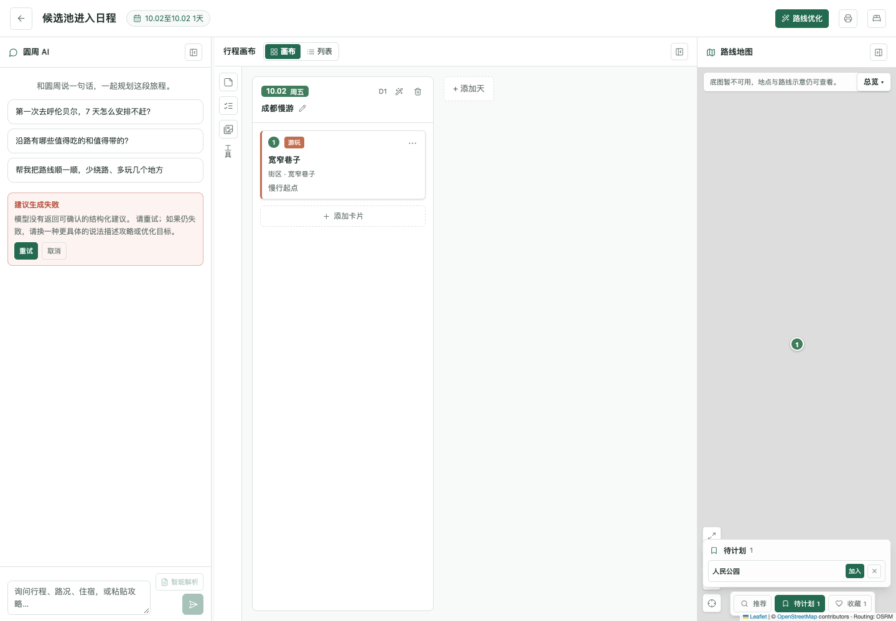
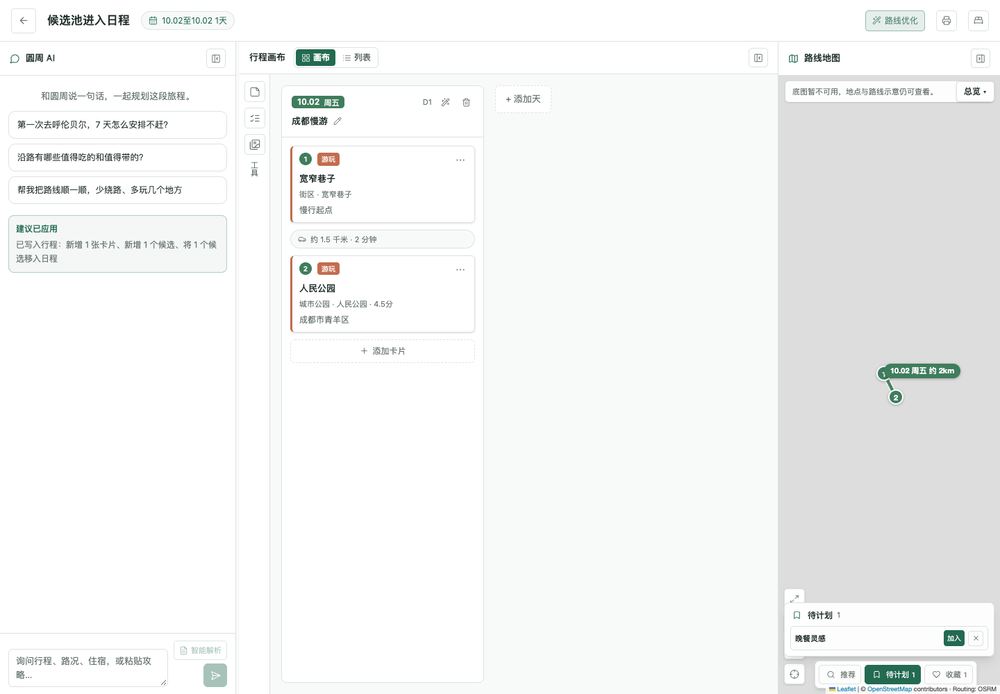

# 候选池原子补丁：真实浏览器证据

同一业务场景：2026-10-02 成都慢游，已有宽窄巷子活动、人民公园 POI 候选与对应收藏。点击现有“路线优化”，模型边界脚本返回一份 `optimize` 建议：新增无坐标的“晚餐灵感”，并将人民公园移入当天。使用生产共享契约、工具、Hono 路由、隔离 SQLite、Vite、浏览器 client 和原生 EventSource；没有替换 HTTP 响应、fetch、SSE 或界面组件。只脚本化外部模型，外部地图/AI 服务关闭。

两图均为真实 Chromium 截图，1440×1000、浅色主题、相同数据与操作。基线为 PR #22 合并提交 `a1f8782e91ed6afcfc1e8dcc25df40db79cb9420`；After 对应本 PR 的实现版本，具体提交 SHA 见 PR 描述。

**Before**：旧应用拒绝包含 Stash 操作的建议；候选和日程未变。



**After**：用户确认后，人民公园进入日程、相邻交通段与地图刷新，收藏保留；纯文本晚餐灵感留在候选池，没有虚构地图点。



## 复现

在安装依赖并执行 `pnpm build:domain` 后运行：

```bash
PLAYWRIGHT_CHROMIUM_EXECUTABLE='/Applications/Google Chrome.app/Contents/MacOS/Google Chrome' \
  node server/src/trip-patch/evidence/browser.cjs
```

脚本自行启动并关闭本地后端和 Vite，输出 `/tmp/stash-after.png`。可用 `STASH_SCREENSHOT_DIR` 改输出目录。除首个场景外，还实际验证：确认前无新增/排期、收藏与已有活动元数据保留、邻接 Leg、原生 AI 事件触发候选重读、纯文本一键排期与原生拖拽、同 POI / 同 amapId 不同 POI id 的多个独立候选选中身份。断言失败以非零退出。

基线复现使用同一脚本与独立基线 checkout：

```bash
STASH_ROOT=/absolute/path/to/baseline-checkout STASH_BEFORE=1 \
PLAYWRIGHT_CHROMIUM_EXECUTABLE='/Applications/Google Chrome.app/Contents/MacOS/Google Chrome' \
  node server/src/trip-patch/evidence/browser.cjs
```

基线 checkout 同样需要安装依赖并构建其自身 domain，不能复用修改后的共享包。基线输出 `/tmp/stash-before.png`。

## 边界

原子性属于 AI TripPatch 路径。现有一键/拖拽继续使用创建卡片、删除候选两个请求与失败补偿，没有把它们描述为单事务。Stash 备注在数据库保留原文；排入日程后沿既有活动读取映射展示，活动标题/备注原有的首尾空白处理保持。未验证外部模型质量、地图服务或部署；本证据不等于整个 Issue #4/#9 验收。
